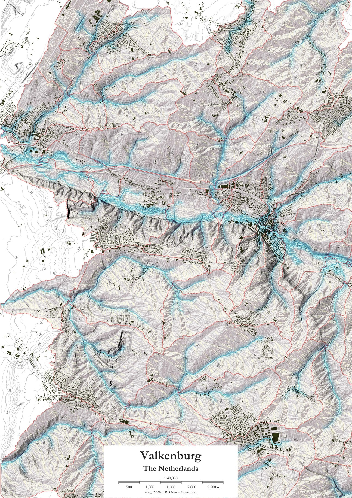

```{=html}
<!-- HERO -->
<section class="dc-hero">
  <div class="dc-hero-left">
    <div class="dc-eyebrow">Assistant Professor · TU Delft · Urban Data Science</div>

    <h1 style="font-family:var(--f-display);font-weight:800;font-size:clamp(3.25rem,5.5vw,5.5rem);line-height:0.73;letter-spacing:-0.04em;color:var(--ink);margin-bottom:0.35rem;">
      Daniele
    </h1>
    <span style="font-family:var(--f-serif);font-style:italic;font-weight:400;font-size:clamp(2.5rem,4.5vw,4.5rem);letter-spacing:-0.02em;color:var(--forest-2);display:block;line-height:1.05;margin-bottom:2.25rem;">
      Cannatella
    </span>

    <p style="font-family:var(--f-serif);font-style:italic;font-size:clamp(1rem,1.4vw,1.15rem);color:var(--muted);line-height:1.7;max-width:400px;margin-bottom:2.75rem;">
      The data revolution is not technical — it is <strong style="font-style:normal;font-family:var(--f-display);font-weight:600;color:var(--ink);">mental.</strong>
      I use spatial data to help design cities that are just, livable, and deeply connected to landscape and nature.
    </p>

    <div class="dc-btns">
      <a href="research.qmd" class="dc-btn dc-btn-lime">View Research</a>
      <a href="docs/CV_Cannatella.pdf" class="dc-btn dc-btn-outline">Download CV ↓</a>
    </div>

    <div class="dc-coord">52.0067° N &nbsp;·&nbsp; 4.3565° E &nbsp;·&nbsp; Delft, NL</div>
  </div>

  <div class="dc-hero-right">
    
    <div class="dc-img-ph">Daniele Cannatella</div>
    <div class="dc-hero-accent"></div>
    <div class="dc-status-card">
      <div class="dc-status-label">
        <span class="dc-badge-dot" style="margin-right:0.4rem;"></span>Now · Active
      </div>
      <div class="dc-status-value">Building Research Team</div>
    </div>
  </div>
</section>

<!-- ABOUT STRIP -->
<div style="display:grid;grid-template-columns:360px 1fr;border-bottom:1px solid var(--border-md);">

  <div style="border-right:1px solid var(--border-md);padding:5rem 2.75rem;background:var(--lime-pale);" class="dc-reveal">
    <div class="dc-eyebrow">About</div>
    <h2 class="dc-heading" style="font-size:clamp(1.5rem,2vw,1.9rem);margin-bottom:1.25rem;">
      Better data.<br><em class="dc-heading-em">Braver cities.</em>
    </h2>
    <p style="font-family:var(--f-display);font-size:0.85rem;line-height:1.8;color:var(--muted);margin-bottom:2rem;">
      Mapping where we are — so we can design where we need to go.
    </p>

    <div class="dc-photo-frame" style="aspect-ratio:3/4;">
      
      <div class="dc-img-ph">Portrait</div>
    </div>

    <div class="dc-tag-row">
      <span class="dc-tag">Urban Resilience</span>
      <span class="dc-tag">Climate Adaptation</span>
      <span class="dc-tag">GIS · R · QGIS</span>
      <span class="dc-tag">Landscape</span>
      <span class="dc-tag">Rbanism</span>
      <span class="dc-tag">AI in Education</span>
      <span class="dc-tag">Data Visualization</span>
    </div>
  </div>

  <div style="padding:5rem 4.5rem;" class="dc-reveal">
    <p class="dc-body" style="font-size:1rem;margin-bottom:1.5rem;">
      I am an Assistant Professor in Urban Data for Design at <strong>TU Delft</strong>, in the Section of Urban Data Science. My work starts from a conviction: the digital revolution gave us not just new tools, but a new kind of thinking. Tools that let us hold complexity — spatial scales from the yard to the planet, temporal scales from a human lifetime to a geological era — all at once.
    </p>

    <div class="dc-pull">
      <p>Data are not neutral. They are political — generated by political will, reflecting it, and dictating it.</p>
    </div>

    <p class="dc-body" style="margin-bottom:1.5rem;">
      When I say I am interested in <strong>new cities</strong>, I mean cities that are just, livable, climate-proof, and in deep relation with nature and landscape — functionally and spiritually. Data can unlock this: by revealing spatial flows, enabling evidence-based adaptation strategies, and making planning processes faster, cheaper, and more democratic.
    </p>
    <p class="dc-body" style="margin-bottom:2rem;">
      I am also a <strong>founding member of the Rbanism Community</strong> and coordinate the Spatial Data and GIS learning line in the MSc Urbanism programme at TU Delft. Lately I have been deeply curious about what AI means for how we teach and practice spatial design.
    </p>

    <div class="dc-btns">
      <a href="about.qmd" class="dc-btn dc-btn-lime">Read more →</a>
      <a href="contact.qmd" class="dc-btn dc-btn-outline">Get in touch</a>
    </div>
  </div>
</div>

<!-- WHAT I WORK ON -->
<div style="border-bottom:1px solid var(--border-md);">
  <div style="padding:3.5rem 4rem 2.5rem;display:flex;justify-content:space-between;align-items:flex-end;border-bottom:1px solid var(--border);">
    <h2 class="dc-heading" style="font-size:clamp(1.75rem,3vw,2.5rem);">What I <em class="dc-heading-em">work on</em></h2>
    <a href="research.qmd" class="dc-btn dc-btn-outline">All Research →</a>
  </div>

  <div class="dc-work-grid dc-reveal">
    <div class="dc-work-card">
      <div class="dc-work-num">01</div>
      <svg class="dc-work-icon" viewBox="0 0 32 32" fill="none" stroke="currentColor" stroke-width="1.4">
        <circle cx="16" cy="16" r="3"/><circle cx="16" cy="16" r="7.5" stroke-dasharray="2.5 2"/>
        <circle cx="16" cy="16" r="13" opacity="0.35"/>
        <line x1="16" y1="2" x2="16" y2="5.5"/><line x1="16" y1="26.5" x2="16" y2="30"/>
        <line x1="2" y1="16" x2="5.5" y2="16"/><line x1="26.5" y1="16" x2="30" y2="16"/>
      </svg>
      <h3 class="dc-work-title">Urban Resilience</h3>
      <p style="font-family:var(--f-display);font-size:0.8rem;line-height:1.8;color:var(--muted);margin-bottom:1rem;">Spatial modeling and risk assessment of how urban systems absorb, adapt to, and recover from climate-related stress.</p>
      <div class="dc-tag-row" style="margin-top:0;">
        <span class="dc-tag">Spatial Modeling</span><span class="dc-tag">Risk Assessment</span><span class="dc-tag">Multi-criteria</span>
      </div>
    </div>

    <div class="dc-work-card">
      <div class="dc-work-num">02</div>
      <svg class="dc-work-icon" viewBox="0 0 32 32" fill="none" stroke="currentColor" stroke-width="1.4">
        <path d="M16 28 C16 28 5 22 5 13 C5 7.5 10.5 3.5 16 3.5 C21.5 3.5 27 7.5 27 13 C27 22 16 28 16 28Z"/>
        <line x1="16" y1="28" x2="16" y2="16"/>
        <path d="M16 21 C12.5 19 9.5 15.5 9.5 13" opacity="0.45"/>
        <path d="M16 17 C19.5 15 22 12 22 10" opacity="0.45"/>
      </svg>
      <h3 class="dc-work-title">Climate Adaptation</h3>
      <p style="font-family:var(--f-display);font-size:0.8rem;line-height:1.8;color:var(--muted);margin-bottom:1rem;">Landscape-based and nature-based strategies for urban adaptation — with quantitative spatial performance analysis across scales.</p>
      <div class="dc-tag-row" style="margin-top:0;">
        <span class="dc-tag">Nature-based Solutions</span><span class="dc-tag">Landscape</span><span class="dc-tag">Impact Assessment</span>
      </div>
    </div>

    <div class="dc-work-card">
      <div class="dc-work-num">03</div>
      <svg class="dc-work-icon" viewBox="0 0 32 32" fill="none" stroke="currentColor" stroke-width="1.4">
        <rect x="3" y="3" width="9" height="9"/><rect x="20" y="3" width="9" height="9"/>
        <rect x="3" y="20" width="9" height="9"/><rect x="20" y="20" width="9" height="9"/>
        <circle cx="12" cy="12" r="1.5" fill="currentColor" stroke="none"/>
        <circle cx="20" cy="20" r="1.5" fill="currentColor" stroke="none"/>
        <line x1="12" y1="12" x2="20" y2="20" stroke-dasharray="2 2" opacity="0.45"/>
      </svg>
      <h3 class="dc-work-title">Spatial Data Science</h3>
      <p style="font-family:var(--f-display);font-size:0.8rem;line-height:1.8;color:var(--muted);margin-bottom:1rem;">Open, reproducible GIS and R-based workflows for urban analysis — making spatial evidence accessible, replicable, and scalable.</p>
      <div class="dc-tag-row" style="margin-top:0;">
        <span class="dc-tag">GIS · R · QGIS</span><span class="dc-tag">Open Data</span><span class="dc-tag">Visualization</span>
      </div>
    </div>
  </div>
</div>

<!-- COLLAB CTA -->
<div class="dc-dark" style="padding:6rem 4rem;position:relative;overflow:hidden;">
  <div style="position:absolute;right:2rem;bottom:-4rem;font-family:var(--f-display);font-weight:800;font-size:22rem;line-height:1;color:rgba(255,255,255,0.03);pointer-events:none;">→</div>
  <div style="max-width:1300px;margin:0 auto;display:grid;grid-template-columns:1fr 1fr;gap:5rem;align-items:start;">
    <div class="dc-reveal">
      <div class="dc-eyebrow" style="color:var(--lime);opacity:0.7;">Open to collaborations</div>
      <h2 class="dc-heading" style="font-size:clamp(2.25rem,4vw,3.5rem);color:white !important;line-height:0.95;">
        Let's make<br>something<br><em style="font-family:var(--f-serif);font-style:italic;font-weight:400;color:var(--lime);">that matters.</em>
      </h2>
    </div>
    <div class="dc-reveal">
      <p style="font-family:var(--f-display);font-size:0.88rem;line-height:1.8;color:rgba(248,247,242,0.5);margin-bottom:1.75rem;">
        I am building a research team and looking for people who want to work on problems that count — urban resilience, climate adaptation, spatial data education.
      </p>
      <div style="border:1px solid rgba(255,255,255,0.1);margin-bottom:2rem;">
        <div class="dc-audience"><div class="dc-audience-label">For students</div><div class="dc-audience-title">MSc & PhD research opportunities</div><div class="dc-audience-desc">Looking for a graduation project or doctoral research in spatial data and urban resilience? Let's talk.</div></div>
        <div class="dc-audience"><div class="dc-audience-label">For researchers</div><div class="dc-audience-title">Joint projects & co-supervision</div><div class="dc-audience-desc">If your work touches urban resilience, climate adaptation, landscape, or data-driven planning — I am open to collaboration.</div></div>
        <div class="dc-audience"><div class="dc-audience-label">For practitioners & municipalities</div><div class="dc-audience-title">Evidence-based spatial partnerships</div><div class="dc-audience-desc">Bringing quantitative methods to places and organisations where they haven't reached yet.</div></div>
      </div>
      <a href="contact.qmd" class="dc-btn dc-btn-lime-inv">Get in Touch →</a>
    </div>
  </div>
</div>

<script>
const obs = new IntersectionObserver(entries => {
  entries.forEach(e => { if (e.isIntersecting) { e.target.classList.add('in'); obs.unobserve(e.target); } });
}, { threshold: 0.08 });
document.querySelectorAll('.dc-reveal').forEach(el => obs.observe(el));
</script>
```
